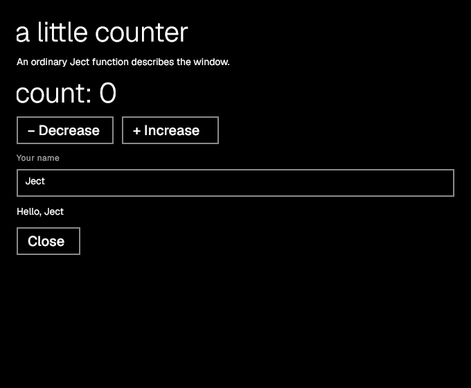

# JGUI

Build desktop interfaces with ordinary Ject functions. JGUI owns the window,
layout, text editing, focus, animation and rendering. Applications need no Rust,
render loop or graphics setup.

The backend uses Brockmann's wgpu toolkit. Choose `metro-dark` or `metro-light`
for its Metro/Swiss appearance, or `linen` / `midnight` for JGUI's color palettes.
The former `egui-light` / `egui-dark` names remain color aliases; egui and eframe
are no longer dependencies.



## A reactive application

```ject
import "jgui" as gui

fn view(state)
    return [
        gui.heading("Count: " + state.count),
        gui.button("increment", "Increment"),
        gui.button("close", "Close", true)
    ]
end

fn update(event)
    if event.id == "increment"
        return {set: {count: event.values.count + 1}}
    end
end

gui.app("Counter", view, update, state={count: 0}, theme="metro-dark")
```

The view receives current state and returns an array of widgets. JGUI runs it
initially and after events, allowing ordinary conditionals, loops and
comprehensions to change the interface. Initialize state read by the first view
in `state={...}`. Newly introduced inputs contribute defaults; existing state
survives reordering, hiding and view rebuilding.

Events contain `{kind, id, value, values}`. Input changes update state before the
handler receives the event. Return `{set: {...}}` to patch state, `{close: true}`
to close, or nil to accept the input's automatic state update. Stable, unique
widget IDs preserve focus and editing state through tree rebuilds. Containers
may also have explicit IDs in their descriptions when their identity matters.

Reactive views use the app's one `on_event` handler. Pass widget callbacks to
`gui.run` for a static document instead; returning callbacks from a reactive
view is rejected, preventing callback handles accumulating on each rebuild.
Handlers run on the interpreter thread and should finish promptly. Background
Ject jobs are not implemented yet.

## Headless tests

```ject
let application = gui.application("Counter", view, update, state={count: 0})
let result = gui.replay(application, [
    {id: "increment", kind: "click", value: true}
])
assert(result.values.count == 1)
assert(result.widgets[0].text == "Count: 1")
```

`replay` uses the actual event/state/view pipeline without a window or GPU. It
returns `{values, widgets, closed}` and stops after a close action. It tests app
logic; it does not prove platform rendering or input behavior.

## Existing documents

`gui.run(title, widgets, state={...})`, `gui.document`, `gui.show`, `gui.validate`
and `gui.dispatch` remain available. Static widget callbacks receive the same
event and action format as the app handler. Defaults from hidden children are
available before the first event; explicit document state wins over defaults.
`dispatch` invokes one callback from initial state without applying its action.
Use `replay` for sequences that apply actions and rebuild views.

## Migration boundaries

This is the first Brockmann-backed release, with intentional differences from
the eframe implementation:

- Password controls fail explicitly rather than displaying secrets unmasked.
- There is one automatically scrolling app viewport. Legacy `scroll` groups
  compose within it; independent nested scroll viewports are not implemented.
- `card`, `group` and `badge` use typographic grouping rather than decorated boxes.
  `wrap` adapts its column count to the window width; grids use equal-width
  columns. Number inputs use editable numeric text rather
  than drag adjustment; slider and picker interactions come from Brockmann.
- `link` emits an app click event; it does not launch a browser automatically.
- Window callbacks remain synchronous. Multiwindow hosting from a callback and
  asynchronous computation require further runtime work. Sequential windows
  reuse the platform event loop.

Brockmann supplies keyboard navigation, Unicode editing, selection, IME,
clipboard, undo/redo, reduced-motion behavior and the accessibility bridge.
The adapter has been exercised on Linux; cross-platform interaction and native
screen-reader testing remain open. Embedded fonts have a finite character set.

## Developing

Run `ject test` in this directory, and `ject run` from `examples/jgui_demo` for
the real window. Native adapter tests run with:

```sh
cargo test --manifest-path native/Cargo.toml -p jgui
cargo clippy --manifest-path native/Cargo.toml -p jgui --all-targets -- -D warnings
```

Brockmann is a portable, licensed source snapshot inside `native/vendor`, not a
path into a developer's home directory. Its provenance and the small hosting
patch are recorded in `native/vendor/brockmann/JGUI-PROVENANCE.md`.
